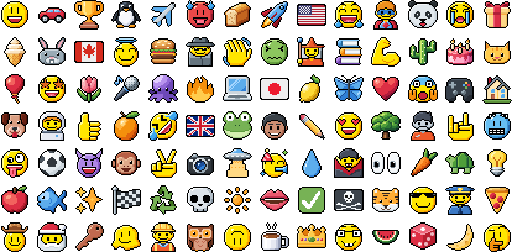

# pixelperfect

**pixelperfect** is an agent skill that teaches an AI coding agent to hand-draw proper 16×16 and 24×24 pixel-art emoji for any subject: objects, animals, food, plants, smileys, people, a portrait of a real person from a photo, symbols and flags.

It's the method behind the 1,948 hand-drawn Pixel emoji on [kirupa.com](https://www.kirupa.com/tools/icon_gallery_pixel.htm), as Kirupa Chinnathambi taught it from first principles, one critique at a time. It has a 14-step procedure, references with right-and-wrong grids and his critiques word for word, about 250 approved drawings to study, and `sprite_tool.py`, a command-line tool that starts sprites from templates, lints them against the house rules and renders review boards.

A random assortment of icons created using this skill:



## Install

The skill is the folder `skills/pixelperfect/`. Every installer copies just that folder, and everything the skill uses is inside it.

### GitHub CLI

`gh skill` is in preview in the GitHub CLI; these commands were tested with gh 2.102.1.

```bash
gh skill install kirupa/pixelperfect pixelperfect
```

That installs into the current repository (`--scope project`, the default) for GitHub Copilot (the default agent when it runs non-interactively). Pick the agent with `--agent`, install for every project with `--scope user`, or name any folder with `--dir PATH`:

```bash
gh skill install kirupa/pixelperfect pixelperfect --agent claude-code --scope user
```

Where it put the skill in testing:

| `--agent` | `--scope user` | `--scope project` |
| --- | --- | --- |
| `github-copilot` | `~/.copilot/skills/pixelperfect` | `.agents/skills/pixelperfect` |
| `claude-code` | `~/.claude/skills/pixelperfect` | `.claude/skills/pixelperfect` |
| `codex` | `~/.agents/skills/pixelperfect` | `.agents/skills/pixelperfect` |
| `cursor` | `~/.cursor/skills/pixelperfect` | `.agents/skills/pixelperfect` |
| `gemini-cli` | `~/.gemini/skills/pixelperfect` | `.agents/skills/pixelperfect` |

`gh skill install --help` lists every supported agent. gh adds a few lines of tracking metadata to the installed copy's `SKILL.md`.

### npx skills

With Node.js, the [`skills`](https://github.com/vercel-labs/skills) CLI installs it too (tested with skills 1.7.6):

```bash
npx skills add kirupa/pixelperfect --skill pixelperfect
```

For every project, for one agent, without prompts:

```bash
npx skills add kirupa/pixelperfect --skill pixelperfect -g -a claude-code -y
```

In testing, `-g -a claude-code` copied the skill to `~/.claude/skills/pixelperfect`. Without `-g`, `-a github-copilot` copied it to `.agents/skills/pixelperfect` in the current project and recorded it in `skills-lock.json`. `npx skills add kirupa/pixelperfect --list` shows what the repository offers without installing anything.

### Copy it yourself

Clone the repository and copy `skills/pixelperfect` to a folder your agent reads skills from. In bash or zsh, for GitHub Copilot on your account:

```bash
git clone https://github.com/kirupa/pixelperfect
mkdir -p ~/.copilot/skills
cp -R pixelperfect/skills/pixelperfect ~/.copilot/skills/
```

In PowerShell:

```powershell
git clone https://github.com/kirupa/pixelperfect
New-Item -ItemType Directory -Force "$HOME\.copilot\skills" | Out-Null
Copy-Item -Recurse pixelperfect\skills\pixelperfect "$HOME\.copilot\skills\"
```

Swap in the folder for your agent:

| Agent | For you, in every project | For one project (inside the repository) |
| --- | --- | --- |
| GitHub Copilot CLI | `~/.copilot/skills/` or `~/.agents/skills/` | `.github/skills/`, `.claude/skills/` or `.agents/skills/` |
| Claude Code | `~/.claude/skills/` | `.claude/skills/` |

For other agents, use the folder `gh skill install` picks for them (the table above).

## Python setup

The skill's tool needs Python 3.9 or newer with Pillow and numpy. Install them into the Python your agent runs. A virtual environment keeps them apart from everything else. In bash or zsh:

```bash
python3 -m venv ~/.venvs/pixelperfect
source ~/.venvs/pixelperfect/bin/activate
python3 -m pip install -r ~/.copilot/skills/pixelperfect/scripts/requirements.txt
```

In PowerShell:

```powershell
py -m venv "$HOME\.venvs\pixelperfect"
& "$HOME\.venvs\pixelperfect\Scripts\Activate.ps1"
python -m pip install -r "$HOME\.copilot\skills\pixelperfect\scripts\requirements.txt"
```

Use the path where you installed the skill. Start your agent from a shell with the environment active, or tell the agent which Python to use.

Two extras are optional:

| Package | Adds |
| --- | --- |
| `resvg_py` | The `twemoji` command and `sheet --twemoji`, which render Twemoji's SVGs. Without it, use `emoji`, your computer's colour emoji font, instead. |
| `fonttools` | On macOS, Apple Color Emoji's own pictures of joined (ZWJ) emoji, such as `emoji 1f468-200d-1f373`. Without it, their parts are drawn side by side. |

```bash
python3 -m pip install resvg_py fonttools
```

## Quick start

Run the tool from the skill's folder. Bare output names go to your work folder, `~/pixelperfect-work`, so drafts never land in a repository.

<!-- quickstart:start -->
```bash
cd skills/pixelperfect
python3 scripts/sprite_tool.py --help
python3 scripts/sprite_tool.py find tangerine
python3 scripts/sprite_tool.py text set:16:1f34a
python3 scripts/sprite_tool.py new my-face --template smiley-16 --out my-face-16.sprite
python3 scripts/sprite_tool.py check my-face-16.sprite
python3 scripts/sprite_tool.py zoom my-face-16.sprite --out my-face-16-zoom.png
python3 scripts/sprite_tool.py sheet my-face-16.sprite --neighbor set:16:1f642 --out my-face-16-board.png
python3 scripts/sprite_tool.py render my-face-16.sprite --scale 8 --out my-face-16.png
python3 scripts/sprite_tool.py emoji 1f34a --out tangerine-system.png
python3 scripts/sprite_tool.py twemoji 1f34a --out tangerine-twemoji.png
```
<!-- quickstart:end -->

In order, these:

1. list every command;
2. find an approved drawing;
3. print it as a text sprite;
4. start a sprite from the 16px smiley template;
5. lint it;
6. make a zoom board with a numbered grid, 1x–3x previews on light and dark, and greyscale;
7. put it beside an approved neighbour;
8. write a PNG;
9. render the subject in your computer's colour emoji font;
10. render it in Twemoji.

Use `cd` with the path where you installed the skill, or give the script's full path. On Windows, type `py` for `python3`.

Each command that writes a file refuses to replace one unless you add `--force`. `emoji` needs a colour emoji font (Apple Color Emoji, Noto Color Emoji or Segoe UI Emoji), or `PIXELPERFECT_FONT`. `twemoji` needs `resvg_py`, plus the internet the first time it renders each code. Everything else works offline.

## Example prompts

Ask your agent in plain words; the skill's description tells it when to load the skill.

- "Use the pixelperfect skill to draw a doughnut 🍩 at 16×16 and 24×24. Show me the review board and grade both against the rubric."
- "Make a pixel emoji of my face from this photo: `https://example.com/me.jpg`. Draw 16×16 and 24×24 versions, in my skin tone and in smiley yellow."
- "Review `cat-16.sprite` against the pixelperfect rubric. Grade it, list what to fix, and fix it."
- "Draw the flag of Brazil and a hot air balloon as 16×16 pixel emoji that match the kirupa.com Pixel set."
- "Redraw my 24×24 rocket natively at 16×16. Don't downscale it."

## How it works

`skills/pixelperfect/SKILL.md` is the procedure. The agent follows 14 steps for every subject:

1. Gather references, and study them.
2. Decide the essence: what to keep, exaggerate and drop.
3. Choose the view and the silhouette.
4. Plan the grid.
5. Block the silhouette and its one black outline.
6. Make curves and diagonals clean.
7. Separate the inside by tone, not by ink.
8. Build colour ramps.
9. Light solid forms; keep flat things flat.
10. Features and faces.
11. Draw the 24×24 natively.
12. People, and portraits from a photo.
13. The review loop.
14. Hand off.

A drawing is done when it meets every line of the acceptance rubric:

- It reads at 1x, on light and on dark.
- The lint is clean.
- It fills the canvas.
- It has one clean outline, with every inner black pixel justified.
- Its curves and diagonals are clean.
- Its symmetry is exact.
- Its ramps stay within budget and keep contrast between parts.
- Its lighting is correct.
- It keeps the subject's identity.
- It sits in harmony with its neighbours.
- Its 16 and 24 match.

Portraits add a blind test and recognition by someone who knows the person. Grade A means one fix away. B sends the agent back to the view and grid, and C back to the essence.

The `references/` folder holds the depth:

- `lessons.md`: Kirupa's critiques and the rules they produced.
- `construction.md`: the grid, outline, circles, diagonals, ramps and light.
- `faces.md`: smileys, people and portraits.
- `worked-examples.md`: eleven approved drawings, decision by decision.
- `review.md`: the rubric in practice, every lint rule, and failures with their fixes.

### Repository layout

```text
pixelperfect/
├── README.md                    this file
├── LICENSE                      MIT, for the code and docs
├── docs/
│   ├── images/                  the assortment of icons in this README
│   └── make_images.py           redraws it with the skill's tool
├── skills/pixelperfect/         the skill; installers copy only this folder
│   ├── SKILL.md                 the 14 steps, the rubric and the commands
│   ├── LICENSE.txt              MIT, a copy that travels with the skill
│   ├── references/              lessons, construction, faces, worked examples, review
│   ├── scripts/                 sprite_tool.py and requirements.txt
│   ├── templates/               smiley, smiley-head, person-head and bust starting points
│   ├── assets/                  the reference library and the artwork license
│   └── examples/                the portrait, lint failures and a Python drawing module
├── tests/test_skill.py          checks the skill
└── .github/workflows/test.yml   runs the tests on Linux, macOS and Windows
```

### Settings

All optional:

| Variable | What it does |
| --- | --- |
| `PIXELPERFECT_WORK` | Where bare `--out` names go (default `~/pixelperfect-work`) |
| `PIXELPERFECT_SET_DIR` | Folders or zips of a full Pixel set's PNGs, named by code or file name, read by `set:` and `find` before the bundled library. Separate several with `:` (`;` on Windows). `--set-dir PATH` does the same for one command |
| `PIXELPERFECT_TWEMOJI_DIR` | Folders or zips of Twemoji `<code>.svg` files, read before the cache and the pinned CDN copy (jdecked/twemoji v17.0.3) |
| `PIXELPERFECT_CACHE` | Where downloads are kept (default `~/.cache/pixelperfect`, `~/Library/Caches/pixelperfect` on macOS, `%LOCALAPPDATA%\pixelperfect` on Windows) |
| `PIXELPERFECT_OFFLINE` | `1` means never download, like `--offline`; cached files still work |
| `PIXELPERFECT_FONT` | A colour emoji font file for `emoji`, when the system's isn't found |

The skill bundles about 250 approved subjects at both sizes. To study all 1,948, download the free PNGs from the [Pixel gallery](https://www.kirupa.com/tools/icon_gallery_pixel.htm) and point `PIXELPERFECT_SET_DIR` at the zip or its folder. Your own reference icons, as PNG or GIF files, work with `text`, `zoom` and `sheet --neighbor`.

### Tests

```bash
python3 -m unittest discover -s tests -v
```

The tests check the skill's frontmatter against the [Agent Skills specification](https://agentskills.io/specification), every link and cited path, the templates and the reference library (lint, and pixel-exact against their checksums), every documented command's options, and this README's quick start, offline, with a throwaway home folder. With PyYAML installed (`python3 -m pip install pyyaml`), they also parse the frontmatter as real YAML. To check an installed copy, set `PIXELPERFECT_SKILL_DIR` to its folder. GitHub Actions runs them on Linux, macOS and Windows with Python 3.9 and 3.13.

## License and credits

- **Code and docs** (the skill's instructions, references, scripts, templates and tests, and this README): MIT, Copyright (c) 2026 Kirupa Chinnathambi (kirupa.com). See [`LICENSE`](LICENSE); [`skills/pixelperfect/LICENSE.txt`](skills/pixelperfect/LICENSE.txt) is the same license, travelling with the skill.
- **Artwork** (the reference library, the portrait, the drawings quoted in the docs and the assortment of icons in this README): kirupa.com's free license for personal and non-commercial use, with credit: "Icons by kirupa.com". You may not redistribute them as an icon set, font or asset pack. See [`skills/pixelperfect/assets/LICENSE.md`](skills/pixelperfect/assets/LICENSE.md) and https://www.kirupa.com/design/icons.htm#license.
- **Commercial use, or the SVG source files:** get [Icon Gallery Pro](https://www.kirupa.com/tools/icon_gallery.htm#pro). The [Icon Gallery](https://www.kirupa.com/tools/icon_gallery.htm) has the whole collection, and the [Pixel gallery](https://www.kirupa.com/tools/icon_gallery_pixel.htm) the full Pixel set.
- **Twemoji:** the Pixel drawings are adapted from the Twemoji designs. Twemoji graphics are Copyright Twitter, Inc. and other contributors, licensed under [CC BY 4.0](https://creativecommons.org/licenses/by/4.0/): https://github.com/twitter/twemoji. This repository contains no Twemoji files. The `twemoji` command downloads Twemoji SVGs from the maintained fork, jdecked/twemoji v17.0.3, when you run it.
- **Emoji names** in the reference catalog come from Emojibase data (MIT); its notice is in `assets/LICENSE.md`.
